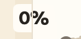

# Bugs

Open bugs to fix. Add new ones at the top.

## 2026-11-10: weekly chart "0%" label runs off the card's left edge

- **Where:** the weekly usage chart (the Limit line, the dashed pace line, T–M day axis). The value label for the current-point dot sits to the left of the dot.
- **Seen:** at the start of the week the dot is at the far left (Tuesday, 0%). The "0%" label, in its white chip, is drawn past the card's left edge, so it overflows the rounded card and gets clipped. The chip also sits over the grey dot.
- **Expected:** keep the label inside the plot. When the dot is near the left edge, put the label on the right of the dot (or above it). Mirror that at the right edge near the end of the week.
- **Check:** also at 100% / near the Limit line (top edge), in light and dark, and in the widget sizes if they draw the same chart.
- **Status:** open, not started.
